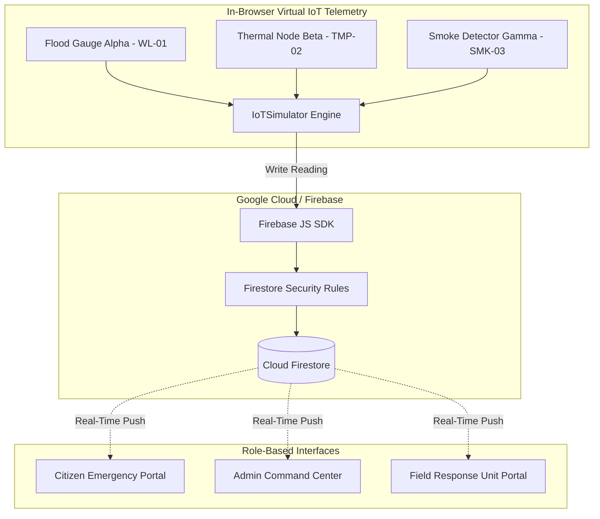

# Cloud-Based Disaster Management & Emergency Response System

**Description:** A cloud-based platform for reporting emergency incidents, managing disaster information, coordinating response teams, and tracking the status of rescue operations.

---

> **Academic Group Project Notice:** This application is developed for an academic evaluation demonstrating **Cloud Computing** and **Internet of Things (IoT)** principles. Sensor readings (water-level, temperature, smoke) are software simulations designed for demonstration on standard laptops and do not connect to physical hardware devices or real-world municipal emergency services.

---

## 1. Problem Statement & Objectives

### Problem Statement
During natural disasters and municipal emergencies (such as urban flash floods, structural collapses, and industrial fires), communication breakdown between trapped citizens, emergency dispatchers, and field response units frequently causes delayed evacuations. Furthermore, physical sensor deployments are difficult to prototype, calibrate, and demonstrate in classroom environments without specialized hardware.

### Key Objectives
1. **Citizen Incident Reporting:** Provide an intuitive, mobile-responsive portal for reporting incidents with categories, severity, locations, and GPS coordinates.
2. **Central Command Management:** Empower dispatch administrators to verify reports, reject duplicates with recorded reasons, assign priorities, and dispatch response units.
3. **Field Response Coordination:** Equip specialized rescue teams with live incident lists, target coordinates, and tactical progress note logging.
4. **Software-Based IoT Simulation:** Model three virtual sensors (Flood Water-Level, Temperature, Smoke Intensity) entirely in software.
5. **Cloud Telemetry Ingestion & Alerting:** Ingest time-series telemetry into Cloud Firestore and trigger autonomous safety threshold alerts.
6. **Real-Time Synchronization:** Stream live incident and telemetry updates to all dashboards using Firestore `onSnapshot` push listeners without custom polling servers.

---

## 2. Technology Stack & Selection Justification

| Technology | Role | Justification |
|---|---|---|
| **React.js 19 + Vite** | Frontend Framework & Build Tool | Lightning-fast Hot Module Replacement (HMR), component-driven architecture, and small production bundle size. |
| **JavaScript (ES6+)** | Application Logic & IoT Engine | Accessible, standardized language suitable for four students collaborating on complex logic. |
| **Standard CSS** | Design System & Styling | Maximum layout control, navy/white theme, micro-animations, and responsive cards without heavy utility library dependencies. |
| **Firebase Authentication** | User Identity & Access Control | Managed cloud auth supporting email/password sessions, token validation, and secure UID binding. |
| **Cloud Firestore** | Cloud Database (NoSQL) | Serverless document store providing real-time data push listeners (`onSnapshot`) without requiring a separate Socket.IO server. |
| **Firebase Hosting** | Static Cloud Deployment | Global CDN distribution, SSL/TLS certificates, and seamless SPA rewrites. |
| **React Router v7** | Client-Side Navigation | Declarative page routing, protected views, and deep-link reference tracking. |
| **Leaflet & OpenStreetMap** | Geospatial Incident Mapping | Lightweight, open-source cartography with zero paid API keys or usage caps. |

---

## 3. Cloud Computing Concepts Demonstrated

1. **Backend-as-a-Service (BaaS):** Eliminates custom backend maintenance by leveraging managed Firebase Authentication and Cloud Firestore services.
2. **NoSQL Document Database:** Document-oriented collections (`incidents`, `sensorReadings`, `sensorAlerts`, `teams`, `users`) offering flexible schemas and horizontal scalability.
3. **Real-Time Data Streaming:** Managed WebSocket push listeners (`onSnapshot`) broadcast changes to clients instantly.
4. **Declarative Cloud Security Rules:** Enforces database-level Role-Based Access Control (RBAC) via `firestore.rules`.
5. **Serverless Static Hosting:** Serves pre-built production assets globally through Firebase Hosting CDN edges.

---

## 4. IoT Concepts Demonstrated

1. **Virtual Sensor Transducers:** Software-modeled physics for Water-Level ($cm$), Temperature ($^\circ C$), and Smoke (Intensity Index $0\text{--}100$).
2. **Telemetry Packet Assembly:** Packages readings with Sensor ID, Metric Unit, Value, Coordinates, and Timestamp.
3. **Threshold Safety Logic:** Autonomous triggers detect when values cross pre-configured critical bounds.
4. **Alert State Machine & Debouncing:** Suppresses redundant alerts when readings remain elevated and re-arms when values return to nominal levels.
5. **Configurable Ingestion Interval:** Simulates edge telemetry frequencies (from 3s presentation mode to 30s eco mode to conserve cloud quotas).

---

## 5. System Architecture & Telemetry Pipeline



### Sensor-to-Cloud Data Flow Sequence
$$\text{Simulated Sensor} \longrightarrow \text{IoTSimulator JS} \longrightarrow \text{Firebase SDK} \longrightarrow \text{Cloud Firestore} \longrightarrow \text{Real-Time Dashboard} \longrightarrow \text{Threshold Alert}$$

---

## 6. Incident Status Lifecycle Workflow

```
[ Reported ] ──► [ Under Review ] ──► [ Verified ] ──► [ Assigned ] ──► [ In Progress ] ──► [ Resolved ]
                        │
                        └──( Invalid / Duplicate )──► [ Rejected ]
                                                        (With reason)
```

---

## 7. Firestore Collection Structure

- **`users`**: `{ uid, email, name, role ('citizen' | 'admin' | 'response_team'), teamId }`
- **`incidents`**: `{ id, referenceNumber, reporterId, category, title, description, location, lat, lng, reportedSeverity, priority, status, assignedTeamId, statusHistory, progressNotes, createdAt }`
- **`teams`**: `{ id, name, specialty, leadName, contact, memberCount, status, activeIncidents }`
- **`sensorDevices`**: `{ id, name, type, unit, threshold, normalRange, location, lat, lng }`
- **`sensorReadings`**: `{ sensorId, sensorType, readingValue, unit, status, isSimulated: true, timestamp }`
- **`sensorAlerts`**: `{ sensorId, readingValue, threshold, severity, status, message, isSimulated: true, createdAt }`
- **`auditLogs`**: `{ action, details, actor, timestamp }`

---

## 8. Local Setup & Execution Guide

### Prerequisites
- Node.js (v18+ recommended)
- Modern web browser (Chrome, Edge, Firefox)

### Step 1: Install Dependencies
```bash
npm install
```

### Step 2: Configure Environment Variables (Optional for Local Preview)
Copy `.env.example` to `.env`:
```bash
cp .env.example .env
```
Fill in your Firebase project credentials from the Firebase Console (see Section 9).  
*Note: If `.env` is omitted or empty, the application automatically runs in **Local Simulation Preview Mode**, allowing full demonstration of all features, roles, and IoT simulations.*

### Step 3: Run Development Server
```bash
npm run dev
```
Open **`http://localhost:5173`** in your browser.

### Step 4: Build for Production
```bash
npm run build
```
The optimized production bundle will be generated in `dist/`.

---

## 9. Firebase Cloud Setup & Admin Provisioning

### Firebase Project Creation
1. Go to [Firebase Console](https://console.firebase.google.com/) and create a new project.
2. Enable **Cloud Firestore** and **Firebase Authentication** (Email/Password).
3. In Project Settings, register a Web App and copy the config credentials into `.env`.

### Secure Admin Creation Process
Public registration never grants administrator rights. To create an administrator:
1. Register an account through `/login` (e.g. `admin@emergency.local`).
2. In the Firebase Console, navigate to **Firestore Database** → `users` collection.
3. Open the document with your user's UID and change `"role": "citizen"` to `"role": "admin"`.
4. The user now has full administrative review, priority assignment, and dispatch capabilities.

### Deploying Firestore Rules & Hosting
```bash
# Install Firebase CLI if needed
npm install -g firebase-tools

# Deploy security rules
firebase deploy --only firestore:rules

# Deploy frontend to Firebase Hosting
firebase deploy --only hosting
```

---

## 10. Suggested Four-Member Academic Division

- **Member 1 (Citizen & Reporting Specialist):** Citizen registration, login, emergency incident reporting form, GPS coordinates, and incident tracking timeline.
- **Member 2 (IoT Simulation & Telemetry Specialist):** Virtual sensors (Water/Temp/Smoke), physics random walks, simulation intervals, demo scenarios, and threshold alert debouncing.
- **Member 3 (Cloud Architecture & Security Specialist):** Firebase centralized config, Firestore schema, declarative security rules (`firestore.rules`), hosting setup, and environment management.
- **Member 4 (Admin Command, Teams & Analytics Specialist):** Admin Command Center, dispatching workflow, response team portal, real-time analytics calculations, and Leaflet map integration.

---

## 11. Viva Defense Questions & Accurate Answers

**Q1: How does the software simulator model IoT sensors without hardware?**  
*Answer:* The `IoTSimulator` module simulates physics by generating bounded random walks for water level ($cm$), temperature ($^\circ C$), and smoke index ($0\text{--}100$), packaging them into structured telemetry payloads and sending them via the Firebase SDK.

**Q2: How do you prevent alert storms when a sensor remains continuously flooded?**  
*Answer:* An alert-state machine flags the sensor as alerted on initial threshold crossing and suppresses subsequent duplicate alerts until the value normalizes and crosses the threshold again.

**Q3: How are Firestore security rules configured to protect private records?**  
*Answer:* Rules check `request.auth.uid == resource.data.reporterId` so citizens can only read their own reports, while administrators with `role == 'admin'` have authorization to verify and dispatch teams.

**Q4: How do dashboard statistics update in real-time without polling?**  
*Answer:* The application attaches Firestore `onSnapshot` listeners that establish a push stream via WebSockets, receiving instantaneous updates whenever records are modified.

---

## 12. Limitations & Future Scope

### Limitations
- IoT sensors run within the browser runtime as an academic simulation rather than physical microcontrollers (e.g. ESP32).
- Leaflet map utilizes simulated Delhi NCR demonstration coordinates.

### Future Scope
- Integration with physical MQTT gateways and hardware ESP32/LoRaWAN sensors.
- SMS/Email notifications via Cloud Functions and Twilio.
- Offline-first caching with Progressive Web App (PWA) service workers.
