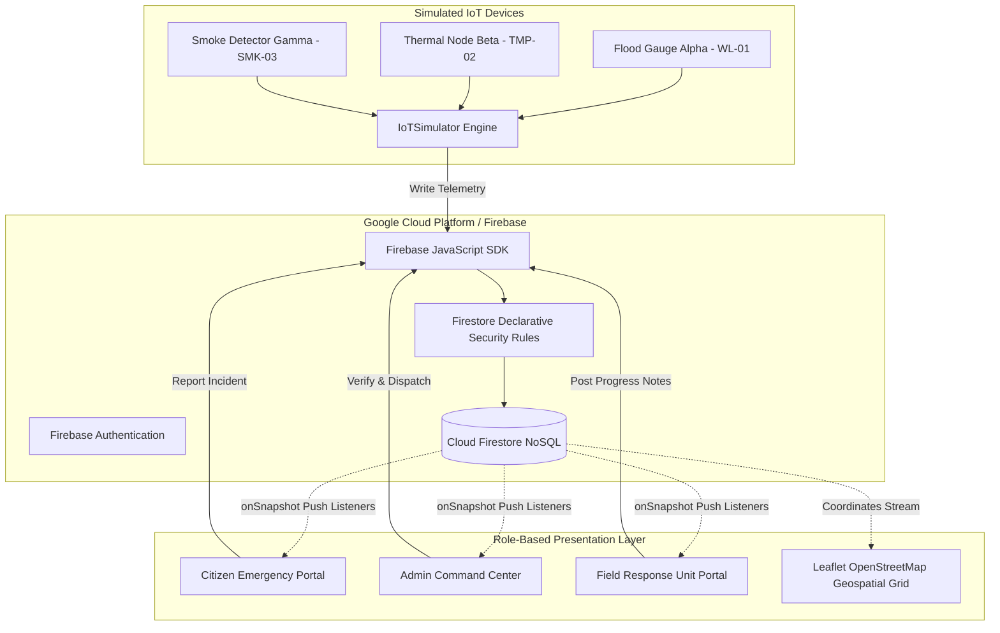

# System Architecture & Technical Specifications

**Project Title:** Cloud-Based Disaster Management & Emergency Response System  
**Description:** A cloud-based platform for reporting emergency incidents, managing disaster information, coordinating response teams, and tracking the status of rescue operations.

---

## 1. High-Level Architecture Overview

The system is architected as a modern, reactive cloud application connecting three operational tiers:
1. **Edge Telemetry Tier (IoT Simulation):** In-browser virtual transducers simulating physical flood gauges, thermal nodes, and air quality detectors.
2. **Backend-as-a-Service (Cloud Tier):** Google Cloud Firestore for real-time document persistence and Firebase Authentication for identity management.
3. **Application & Presentation Tier:** Single-Page Application (SPA) built with React.js, Vite, standard CSS, and Leaflet cartography.



---

## 2. IoT-to-Cloud Data Flow Pipeline

The system visibly demonstrates the 6-stage telemetry ingestion pipeline:

1. **Virtual Sensor Simulation:** Software models generate physics readings (water level in cm, temperature in °C, smoke index 0-100) using controlled random walks and scenario drivers.
2. **Telemetry Packet Assembly:** The `IoTSimulator` engine packages each reading with sensor ID, timestamp, coordinates, and status.
3. **Firebase SDK Transmission:** Asynchronous non-blocking writes transmit data to Cloud Firestore collection `sensorReadings`.
4. **Cloud Database Storage:** Firestore persists packets with server timestamps.
5. **Real-Time Push Synchronization:** Active dashboards receive live snapshot notifications via `onSnapshot` WebSocket listeners without polling.
6. **Threshold Safety Alerting:** When telemetry exceeds safety bounds, an alert state machine triggers a prioritized incident record in `sensorAlerts`.

---

## 3. Incident Lifecycle Workflow

```
[ Citizen Files Incident ]
          │
          ▼
   ( Status: Reported )
          │
          ▼
[ Admin Reviews Incident ] ──( Invalid / Duplicate )──► [ Status: Rejected ]
          │                                                   (With recorded reason)
          ▼
   ( Status: Verified )
          │
          ▼
[ Admin Dispatches Team ]
          │
          ▼
   ( Status: Assigned )
          │
          ▼
[ Responders Arrive On-Scene ]
          │
          ▼
 ( Status: In Progress ) ◄───► [ Post Tactical Updates ]
          │
          ▼
[ Rescue Operation Concluded ]
          │
          ▼
   ( Status: Resolved )
```

---

## 4. Role-Based Access Control (RBAC) Architecture

- **Citizen:** Unprivileged public user. May register freely, report incidents, and read exclusively their own private reports. Cannot assign priority or dispatch teams.
- **Administrator:** Privileged dispatcher. Provisioned through secure Firebase Console procedures. Reviews reports, sets priority, rejects invalid entries, and manages teams.
- **Response Team:** Field operative. Scoped exclusively to assigned operations. Updates status to 'In Progress' or 'Resolved' and logs on-scene progress notes.
